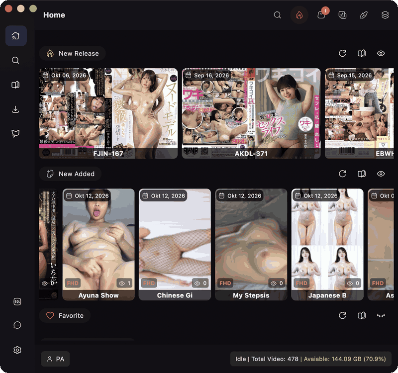
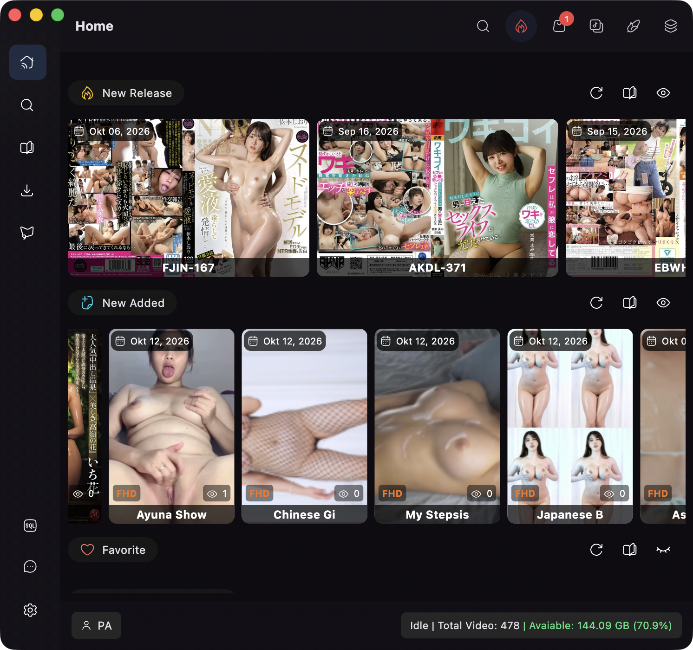
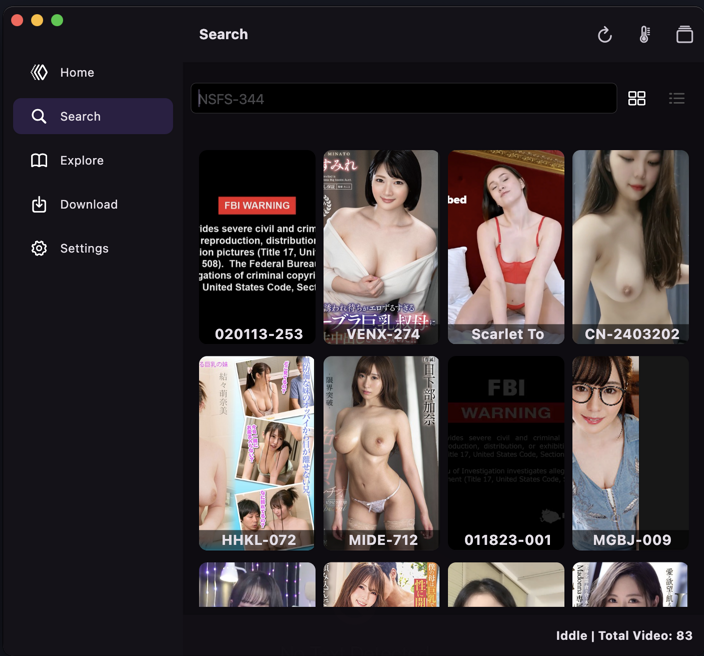
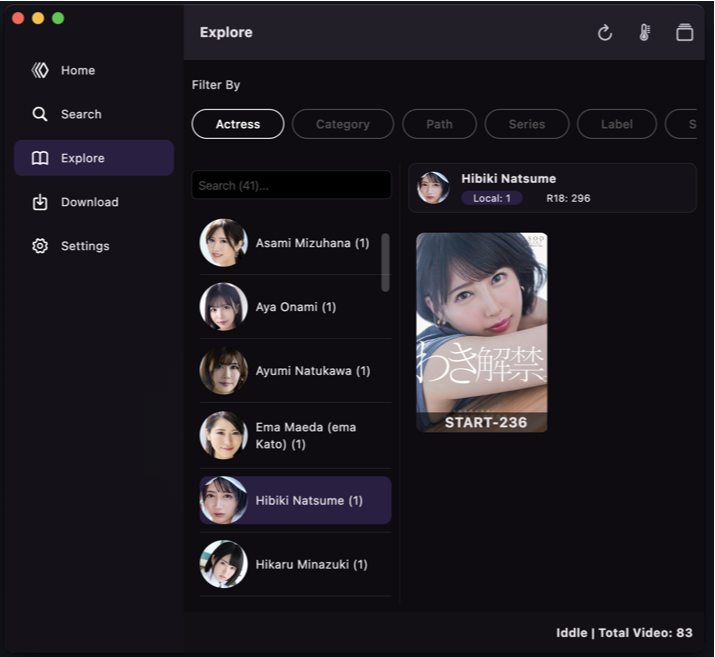
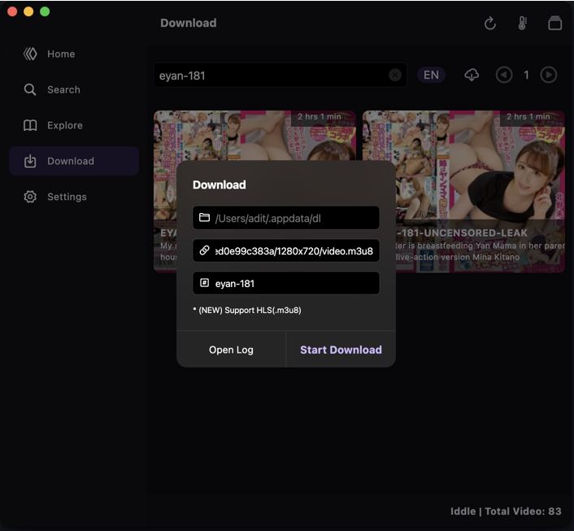

# JavIt Desktop 🇯🇵

> **NSFW** — A macOS desktop app for organizing and playing a local Japanese Adult Video (JAV) collection.

JavIt turns video folders on your Mac or external drives into a searchable personal library. Add a folder, let the app scan its videos, enrich recognized video codes with metadata, then browse, search, play, and manage the collection from one place.



## What It Does

- Add a library by selecting or drag-and-dropping a video folder.
- Scan supported local video files and keep registered libraries in sync.
- Detect JAV video codes from filenames and look up matching metadata from the local R18 database.
- Browse recent releases, recently added videos, favorites, most watched videos, unwatched videos, and random picks.
- Search the local collection by video code, title, path, actress, category, and other filters.
- Play local files with playlist support, mini player, fullscreen, playback speed, volume persistence, and watch tracking.
- Explore metadata by actress, series, category, and year.
- Find large files and possible duplicates, scan video quality, and manage simple todos.
- Search and download supported releases from the Download page.

## How It Works

```text
Local video folders
        |
        v
Scan files and detect video codes
        |
        +--> R18 database lookup for metadata
        |
        v
javit.db personal library
        |
        v
Home, Search, Explore, Tools, and Player
```

JavIt uses two SQLite databases:

- **`javit.db`** stores your libraries, local video records, favorites, collections, watch sessions, achievements, activities, and search indexes.
- **`r18_YYYYMMDD.db`** is the external metadata catalog used to enrich recognized JAV files with titles, actresses, categories, studios, artwork, trailers, and more.

Files without a recognized code are still added to the library as local videos using their filename as the title.

## Search Modes

The Search page has two modes:

- **Regular search** searches the local video records directly.
- **AI Search** is a fully local, heuristic ranking system. It combines token matching, trigrams, synonyms, metadata fields, and simple thumbnail-derived tags such as `outdoor`, `bright`, or `portrait`.

AI Search is useful for broad metadata-oriented queries such as `subtitle indo outdoor`. It is not yet a full vision-language search system, so it should not be expected to reliably answer detailed visual queries such as “pink shirt”. Use **Settings → Generate Missing Embeddings** or **Reindex All** after adding or changing videos when using this mode.

## Screenshots

| Home | Search |
|---|---|
|  |  |

| Explore | Download |
|---|---|
|  |  |

## Tech Stack

- [Flutter](https://flutter.dev/) desktop
- [GetX](https://pub.dev/packages/get) for state management and dependency injection
- [SQFlite](https://pub.dev/packages/sqflite) for local SQLite storage
- [media_kit](https://pub.dev/packages/media_kit) and libmpv for playback
- [Dio](https://pub.dev/packages/dio) for networking and downloads

## Requirements

JavIt is currently developed and tested on macOS. Install the following first:

- macOS with Xcode and Command Line Tools
- Flutter SDK with Dart SDK `^3.5.3`
- CocoaPods
- Homebrew
- Python 3
- `gunzip` (usually available on macOS)

Install the native dependencies:

```bash
brew install cocoapods python libiconv ffmpeg
```

Enable Flutter desktop support and verify the environment:

```bash
flutter config --enable-macos-desktop
flutter doctor
```

## Local Setup

Create the local environment file, fetch packages, and generate `lib/env.g.dart`:

```bash
cp .env.sample .env
flutter pub get
dart run enven
```

Run the macOS app:

```bash
flutter run -d macos
```

## First Run and R18 Database Setup

On launch, JavIt looks for an `r18*.db` file in its app data directory. If one is missing, the app shows a **Download & Install** prompt.

The setup process downloads the R18 dump, extracts it with `gunzip`, then runs `r18_to_javit.py` with Python to create the SQLite database. The import can take several minutes; keep the application open until it finishes, then restart the app.

## Troubleshooting

If the macOS app fails to launch with the following error:

```text
Library not loaded: /opt/homebrew/opt/libiconv/lib/libiconv.2.dylib
```

Reinstall the native dependencies and rebuild:

```bash
brew reinstall libiconv ffmpeg
brew link --overwrite libiconv
flutter clean
flutter pub get
dart run enven
flutter run -d macos
```

## Contributing

JavIt started as a hobby project and currently targets macOS. Contributions and pull requests, including work toward other desktop platforms, are welcome.
